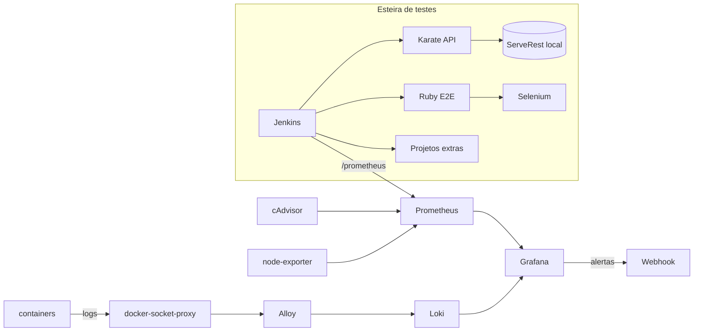

# DevOps Observability Stack

Ambiente de CI com observabilidade, subindo com um comando: **Jenkins** executa os testes, **Prometheus** coleta as métricas, **Loki** guarda os logs e o **Grafana** mostra tudo em painéis prontos.

> **Status:** os arquivos foram escritos e validados estaticamente (`docker compose config`, YAML e JSON). **O ambiente ainda não foi executado.** Siga a [primeira execução](#primeira-execução) e confira os pontos de atenção no final.

## Componentes

| Serviço | Função | Porta |
|---|---|---|
| Jenkins | CI configurado por código (JCasC), com os jobs `karate-api-tests`, `ruby-e2e-tests` e `esteira-qa` | 8080 |
| ServeRest | API local alvo dos testes do Karate e do Cypress (porta 3001 no host) | 3001 |
| docker-socket-proxy | Dá ao Alloy só leitura de containers e logs, sem expor o `docker.sock` inteiro | - |
| Selenium | Navegador (Chromium) dos testes de UI do Ruby; ver ao vivo em :7900 (senha `secret`) | 4444 / 7900 |
| Prometheus | Métricas do Jenkins, containers e host | 9090 |
| Loki | Armazenamento de logs (retenção de 7 dias) | 3100 |
| Alloy | Coleta os logs de todos os containers e envia ao Loki | 12345 |
| Grafana | Painéis de métricas e logs | 3000 |
| cAdvisor | Métricas de CPU, memória e rede por container | 8081 |
| node-exporter | Métricas do host | 9100 |

O Alloy substitui o Promtail, que chegou ao fim da vida em 02/03/2026.



## Primeira execução

Requisitos: Docker Desktop com Compose v2 e cerca de 4 GB de memória livre.

```bash
cp .env.example .env        # edite e troque as senhas
docker compose up -d --build
docker compose ps           # aguarde o jenkins ficar "healthy" (1 a 2 minutos)
```

Acessos:
- Jenkins: http://localhost:8080 (usuário e senha do `.env`)
- Grafana: http://localhost:3000 (usuário e senha do `.env`), pasta **Observabilidade**
- Prometheus: http://localhost:9090/targets (todos os alvos devem estar `UP`)

Depois, no Jenkins, abra o job **esteira-qa** e clique em **Build with Parameters**. Ela dispara em paralelo os testes de API do Karate e os E2E do Ruby. Ao terminar, os painéis do Grafana passam a mostrar dados.

## Esteira de testes

| Job | O que faz | Repositório |
|---|---|---|
| `esteira-qa` | Dispara os dois jobs abaixo em paralelo; roda de seg. a sex. de manhã (cron) | - |
| `karate-api-tests` | `mvn test` contra o ServeRest local do compose (parâmetros: tags, ambiente `docker` ou `dev`, threads) | [karate-api-framework](https://github.com/David-Nascimento/karate-api-framework) |
| `ruby-e2e-tests` | Cucumber no perfil escolhido (`ci`, `api`, `smoke`, `a11y`, `regression`); a UI roda no Selenium do compose | [ruby-e2e-framework](https://github.com/David-Nascimento/ruby-e2e-framework) |

Cada build tem, no menu lateral, as abas **Allure Report** (Karate e Ruby) e **Karate Report** (só o Karate), além dos resultados JUnit. O Allure mostra histórico, categorias de falha, passos e anexos; o Ruby usa o formatador nativo do Allure e o Karate entra pelo JUnit XML (com menos detalhes que o relatório nativo do Karate).

Para parar: `docker compose down` (acrescente `-v` para apagar também os dados).

### Projetos extras (opcionais)

Gerados a partir dos repositórios do GitHub, em `jenkins/casc/jobs/projetos-extras.groovy`. Rodam isolados ou pela `esteira-qa` marcando **INCLUIR_EXTRAS** (um por vez; falha neles deixa a esteira *instável*, sem reprovar):

| Job | Repositório | O que roda |
|---|---|---|
| `cypress-api-serverest` | desafio-api-qa | Cypress (API) contra o ServeRest local |
| `playwright-cronicas-battleon` | cronicas-de-battleon | build, checagem de tipos e testes E2E (Playwright) |
| `qa-playground-checks` | QA-Playground | build + `npm run qa` (DOM, links e contrato da API mock) |
| `ruby-api-httparty` | Httparty-Cucumber-Structury | Cucumber + HTTParty contra o Petstore (serviço externo, pode oscilar) |
| `ruby-unit-rspec` | unit-testes-ruby | RSpec (unitários) |

Para incluir outro projeto, acrescente um item na lista do arquivo (há modelos de comando para Node e Ruby).

## Painéis do Grafana

- **Jenkins e esteira de testes**: resultado, duração e testes do último build de cada job (Karate e Ruby), fila e executores.
- **Containers e host**: CPU, memória e rede por container; CPU e memória do host.
- **Logs dos containers**: volume por serviço, linhas com erro e busca com filtro por serviço.

## Estrutura

```
├── docker-compose.yml
├── .env.example
├── jenkins/        Dockerfile, plugins.txt e casc/ (JCasC e os jobs: Karate, Ruby e esteira)
├── prometheus/     prometheus.yml
├── loki/           loki-config.yaml
├── alloy/          config.alloy
└── grafana/        provisioning/ (fontes de dados) e dashboards/
```

## Alertas

O Grafana já vem com 4 regras (pasta **Observabilidade**, em *Alerting > Alert rules*):

| Regra | Dispara quando |
|---|---|
| Build com falha | o último build de `karate-api-tests`, `ruby-e2e-tests` ou `esteira-qa` falhou |
| Alvo de monitoramento fora do ar | qualquer serviço deixa de responder ao Prometheus por 2 minutos |
| Fila do Jenkins acumulada | mais de 5 builds na fila por 10 minutos |
| Memória do host acima de 90% | por 5 minutos |

As notificações saem por um **webhook** configurado em `ALERT_WEBHOOK_URL` no `.env` (Slack, Teams, Discord, n8n e similares). Sem a variável, os alertas aparecem apenas na tela do Grafana. Para Telegram ou e-mail, crie o contato em *Alerting > Contact points* e aponte a política padrão para ele. Depois de mudar o `.env`: `docker compose up -d grafana`.

## Gatilhos automáticos

Os jobs `karate-api-tests` e `ruby-e2e-tests` consultam o GitHub a cada ~10 minutos e rodam quando há commit novo. A `esteira-qa` roda de segunda a sexta de manhã. (Webhook do GitHub exigiria um Jenkins acessível pela internet.)

## Histórico do Allure

O histórico de cada job fica em `jenkins_home/allure-history`, então o Allure mostra a tendência entre builds (a partir do segundo build).

## Operação

Comandos do dia a dia:

```bash
docker compose up -d --build                         # sobe tudo
docker compose up -d --build --force-recreate jenkins   # aplica mudanças em JCasC e jobs
docker compose logs -f --tail 150 jenkins            # logs (troque por grafana, loki...)
docker compose ps                                    # estado e saúde dos serviços
.\scripts\backup.ps1                                # backup dos volumes (PowerShell)
./scripts/backup.sh                                  # backup dos volumes (Linux/macOS/Git Bash)
```

Restaurar um volume (com a stack parada): `./scripts/restore.sh backups/<pasta> jenkins_home`.

**Fixar versões:** as imagens usam `latest` por padrão. Descubra a versão em uso (`docker compose exec prometheus prometheus --version`, `docker compose exec loki loki -version`, `docker compose exec alloy alloy --version`; no Grafana, o rodapé da tela) e informe no `.env` (`GRAFANA_VERSION`, `LOKI_VERSION` etc., ver `.env.example`). O ambiente deixa de mudar sozinho.

**Validar antes de subir ou commitar:** `.\scripts\validar.ps1` (PowerShell) ou `./scripts/validar.sh`. Há também o workflow manual `.github/workflows/validar.yml`.

## Diagnóstico: Jenkins ou Grafana sem dados

1. **Jobs ausentes no Jenkins**: a configuração por código é lida quando o Jenkins inicia. Rode `docker compose up -d --build --force-recreate jenkins` e confira os erros com `docker compose logs jenkins` (procure `casc`, `Job DSL` e `ERROR`).
2. **Prometheus**: abra http://localhost:9090/targets. O alvo `jenkins` precisa estar `UP`. Se estiver `DOWN`, veja a mensagem de erro ali; teste também `http://localhost:8080/prometheus/`.
3. **Painéis vazios**: as métricas de cada job só aparecem depois do primeiro build terminar, e o plugin as atualiza a cada 15 segundos. Rode um build e aguarde. Em http://localhost:9090/graph pesquise `default_jenkins_builds_last_build_result_ordinal`; o rótulo do job é `jenkins_job`.
4. **Allure em branco**: confirme que o Jenkins subiu com a opção `DirectoryBrowserSupport.CSP=` do compose (`docker compose up -d --force-recreate jenkins`).

## Pontos de atenção

- **Nomes das métricas do Jenkins**: os painéis usam nomes como `default_jenkins_builds_last_build_tests_total` com o rótulo `jenkins_job`. Se algum painel ficar vazio, procure em http://localhost:9090/graph por `jenkins_builds_last_build` e ajuste a consulta.
- **Allure**: a versão do CLI é o argumento `ALLURE_VERSION` do `jenkins/Dockerfile`. A segurança do Jenkins é relaxada (CSP vazio) para exibir o relatório; use só em ambiente local.
- **cAdvisor no Docker Desktop (Windows/WSL2)**: pode não preencher o nome dos containers em todos os painéis. Em Linux nativo funciona completo.
- **Versões**: as imagens do Grafana, Prometheus, Loki e Alloy usam `latest`. Fixe as versões no `docker-compose.yml` antes de usar fora de estudo.
- **Segurança**: o Alloy lê os logs por um proxy de socket (somente leitura de containers), mas o cAdvisor roda privilegiado, o Jenkins está sem a política CSP e o acesso é por HTTP. Adequado para ambiente local; em servidor, coloque um proxy reverso com HTTPS (Traefik ou Caddy), restrinja a rede e guarde segredos nas credenciais do Jenkins. Se os logs deixarem de chegar ao Loki, confira `docker compose logs alloy` e `docker-socket-proxy`.
- **Ruby no Jenkins**: o Ruby vem do Debian (apt) e as gems instalam em `vendor/bundle` dentro do workspace. Se a instalação de alguma gem nativa falhar, o log do build mostra qual pacote do sistema falta.
- **Logs de build**: o Grafana mostra os logs do próprio Jenkins (container). O log detalhado de cada build fica na interface do Jenkins.

## Próximos passos sugeridos

- Agente Jenkins separado em container para executar os builds (hoje o Jenkins roda Maven, Ruby e usa o Selenium do compose).
- Credenciais do Jenkins para segredos, assim que algum job precisar de token.
- HTTPS com proxy reverso (Traefik ou Caddy), se for sair do ambiente local.
- Regra de qualidade: reprovar a esteira abaixo de uma taxa mínima de sucesso.
- Capturas de tela dos painéis e um GIF da esteira rodando, para o README.
- Ruby E2E: o primeiro build baixa as gems (alguns minutos); depois use cache no volume.
- Integração com o repositório `karate-api-framework` via webhook.
